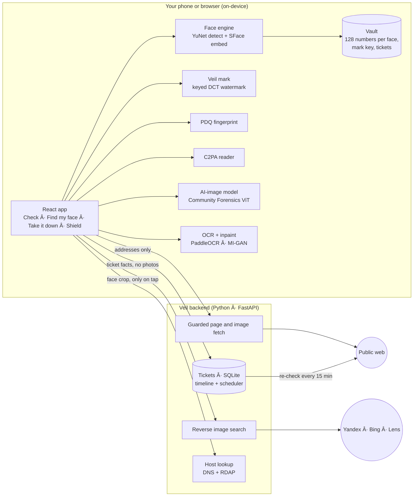
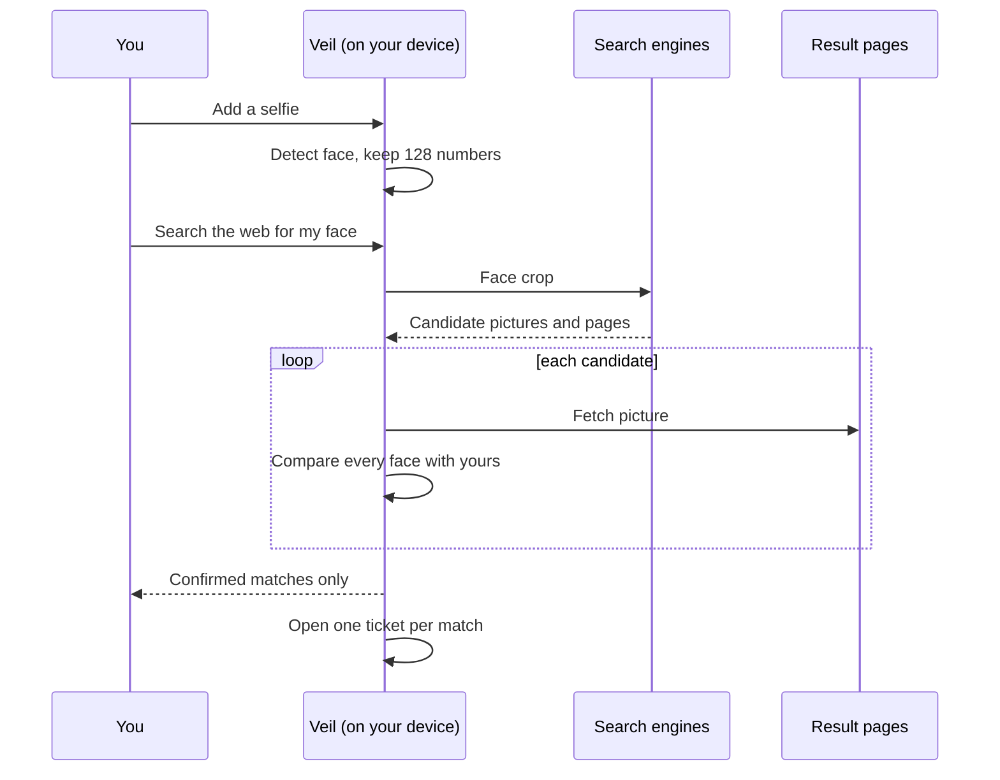
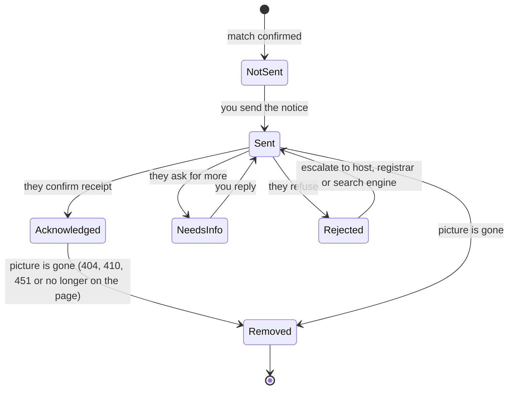

# Veil

**Someone made a fake of you. Veil helps you prove it, find it and take it down, from your phone.**

Veil is a deepfake-defence app for ordinary people. It checks whether a picture has been faked or altered, searches the web for where your face has been posted, opens a takedown ticket for every confirmed match, and marks your photos before you post them so a fake made from one can be traced back to you. It runs as a website and as an Android app from one codebase.

Built at Wildfire Ignite (Dakota State University, November 2026).

## The problem

A convincing fake of a real person now takes one photo and a few minutes. The person in it usually finds out late, cannot tell where else it has spread, and faces a different report form on every site. Services that do this work today are sold to celebrities and brands at hundreds of dollars a month, and most ask you to upload your face or ID to their servers.

## What Veil does

| | What you get | How it works |
|---|---|---|
| **Check** | A plain answer about one picture, with the evidence behind it | Signed Content Credentials (C2PA), a comparison with your original photo, your own Veil mark, file metadata, the camera's embedded preview, and an AI-image model. Only facts about the file count as proof; a model score is shown as a lead. |
| **Find my face** | Every place Veil can find your face | One tap runs reverse image searches with a crop of your face, opens each result, and compares every face in it with yours on your own device. Only confirmed matches are kept. |
| **Take it down** | One ticket per match, tracked to the end | The right destination (platform report form, or the host's abuse address from DNS and RDAP), a written notice, an evidence file with hashes, and re-checks that close the ticket when the picture is really gone. |
| **Shield** | A copy of your photo that is safe to post | An invisible keyed watermark (the Veil mark), all metadata removed, and street signs, house numbers and plates painted out after you confirm them. |
| **Remove details** | The same photo without the things that say where you live | Reads the text in the photo on the device, lists street names, house and room numbers, plates, emails and phone numbers, and paints out the ones you confirm, letter by letter, so the sign or plate keeps its shape. |
| **Video evidence** (web) | The moments in a video worth a look, and a record nobody can quietly edit | Frames are sampled across an MP4 or MOV and run through the same AI-image and face models as Check, plus cuts, patch-like changes and sound jumps, all on the device. Signed Content Credentials in the file are verified. The record carries the file's SHA-256, a hash-chained handling log, a signature from a key that never leaves the device, and a time stamp from Veil's server, which sees only a hash. Anyone can drop the record back into Veil to re-check it. |

### What makes it different

- **Your face stays on your device.** Face matching runs on the phone. Veil keeps your face as 128 numbers and never stores the selfie. Only the crop you choose to search with leaves the device, and only when you tap search.
- **It proves origin, not just resemblance.** The Veil mark and the compare-with-original check show that a fake was made from *your* photo.
- **It says only what it can show.** Search results are "candidates" until your face is confirmed in them. A removal claim in an email does not close a ticket; the picture being gone does. A model's opinion is never called proof.
- **It shows its reasons.** Under every verdict Check lists up to three measured signs of tampering and up to three signs the picture was left alone. Your own Veil mark is shown separately as where the picture came from.
- **It is free for the person being targeted.** Everything above runs on the user's device, so it costs almost nothing to offer.

## How it works



The Android app carries the same engines and talks to the web directly through native HTTP, so it works without the backend.

### Finding your face



### A ticket's life



A ticket closes only when a re-check sees the picture gone. Timeouts, blocked requests and server errors are recorded as "could not tell".

## What we measured

All numbers are from this repository's verification scripts on a laptop and a Pixel 7. Private photos stay outside the repository.

| Test | Result |
|---|---|
| Face matching, team's real photos (2 people, 10 faces) | Same person, front-facing: 0.56 to 0.94. Different people: -0.12 to 0.12. Threshold 0.36. No false match. |
| Check on 12 real camera photos | 0 false alarms |
| Same real photo as suspect and original | "Nothing differs", verdict unchanged |
| Real web search from one public-domain portrait | 60 candidates from Yandex; 44 of 55 loadable candidates confirmed as the same face (web), 48 of 55 on the Pixel in 70 s |
| Veil mark on a real selfie after re-posting | Found at 1080 px quality 70, 720 px quality 60, and after a screenshot-style resize; not found in the unmarked original |
| Ticket lifecycle against live addresses | Page answering 200 stays "Sent"; address answering 404 closes as "Removed" on screen and in the backend |
| Shield on real photos | Lists only details that two separate reads agree on (plate, street sign, room number); nothing else is suggested |
| Remove details on a real street-sign photo (web and Pixel 7) | Both signs' text removed letter by letter; the plates keep their shape (`scripts/verify/e2e-clean-sign.mjs`) |
| Video evidence on an 18 s clip with an AI-made insert at 9 to 13 s | Marked 9.6 to 12.9 s; a tampered record and a different video are both caught (`scripts/verify/e2e-video.mjs`) |
| Automated tests | 386 TypeScript tests, 94 Python tests |

### Known limits

- **The face-forgery model is a lead, never a verdict.** At the level Veil uses it caught 25 of 60 sample fakes and wrongly flagged 2 of 60 real faces ([docs/face-swap-detector-evaluation.md](docs/face-swap-detector-evaluation.md)). On its own it can only raise "Worth a closer look"; in video it needs two neighbouring frames to agree.
- **A web search rarely finds a private person.** Search engines return look-alikes: on a real search two strangers scored 0.38 and 0.39 against a team member's face, so a web result needs 0.50 before Veil calls it your face. A page you point Veil at uses the normal 0.36.
- **Video is sampled.** 12 to 30 frames per video are examined, not every frame, and the model scores are not calibrated for video. Video evidence marks moments for a person to review; it does not rule a video real or fake. It is in the web app only: a scan takes minutes on a phone.
- **Thick, embossed numbers can leave a faint trace** after Remove details; the app re-scans its own export and says when text is still detected.
- **Side profiles are mostly missed** by face matching (0.25 to 0.38 against front-facing photos of the same person).
- **The Veil mark does not survive every edit.** Cropping 10% from all four sides removes it; only single-edge crops are recovered. Survival through full AI regeneration has not been measured.
- **Shield does not stop an AI model from reading or editing a photo.** Nothing invisible does. It makes fakes traceable and removes location details.
- **Search coverage is what the engines return.** Bing's upload endpoint currently returns no usable results and is reported as failed. Google Lens needs a SerpApi key.
- **Sending from Gmail** needs a Google OAuth client ID and has not been tested against a live account. Without it, tickets open in your own mail app.
- **Paid plans are not live.** The Personal and Enterprise pricing on the site is our opening offer for after the hackathon; team features such as roles, an access log and retention settings are not built yet.

## Setup

Requirements: Node 24, Python 3.11, and for Android: JDK 21 and the Android SDK.

```bash
git clone https://github.com/coldMEW/veil.git
cd veil
npm ci
```

### Run the web app

```bash
npm run dev            # http://localhost:5173
```

The first run downloads the on-device models (about 205 MB) into `public/models/` and verifies each one by SHA-256, so it needs an internet connection once. In this mode the app's `/api` routes are served by the dev server itself, including the time stamp for Video evidence records; its signing key is created on first use in `local-private/`, which Git ignores. Use Chrome or Edge.

### Run with the Python backend

```bash
python -m venv .venv
.venv/Scripts/python -m pip install -r backend/requirements.txt   # macOS/Linux: .venv/bin/python
VEIL_DB=./veil-tickets.sqlite3 .venv/Scripts/python -m backend    # http://127.0.0.1:8787
VEIL_BACKEND=python npm run dev                                   # dev server proxies /api to the backend
# Windows PowerShell: $env:VEIL_DB='veil-tickets.sqlite3'; .venv\Scripts\python -m backend
#                     $env:VEIL_BACKEND='python'; npm run dev
```

For a single production process, run `npm run build` and then `python -m backend`: it serves the built app and the API together. (That process has no time-stamp endpoint, so Video evidence records made there are signed by the device only.)

| Setting | Where | Purpose |
|---|---|---|
| `VITE_GOOGLE_CLIENT_ID` | `.env` | Enables "Send from my Gmail". Steps in [.env.example](.env.example). |
| `SERPAPI_KEY` | server environment | Adds Google Lens results |
| `SMTP_*`, `IMAP_*` | server environment | Optional server-side sending and reply reading |
| `VEIL_DB` | server environment | SQLite ticket database path |
| `VEIL_WITNESS_KEY` | server environment | P-256 private key (PKCS#8 PEM) for Video evidence time stamps on a deployed server. Locally a key is generated for you. |

### Build the Android app

```bash
npm run build:android
cd android && ./gradlew assembleDebug      # app/build/outputs/apk/debug/app-debug.apk
adb install -r app/build/outputs/apk/debug/app-debug.apk
```

### Test and verify

```bash
npm run typecheck && npm test                       # TypeScript
python -m pytest backend/tests -q                   # backend
python scripts/verify/run.py --serve                # drives the real app in Chromium
node scripts/verify/e2e-identical.mjs <photo>       # same photo as suspect and original
node scripts/verify/e2e-video.mjs <video.mp4>       # Video evidence: scan, seal, then catch a tampered record
node scripts/verify/e2e-clean-sign.mjs <photo>      # Remove details on a photo with a sign or plate
node scripts/verify/e2e-hunt.mjs <public photo>     # real web search through the UI
node scripts/verify/real-faces.mjs <folder>         # face similarity matrix for your own photos
node scripts/verify/device-e2e.mjs                  # the installed Android app over USB (adb on PATH, or set ADB)
```

The `e2e-*.mjs` drivers expect the app at `VEIL_URL` (default `http://localhost:5173`) and Playwright's Chromium: `npx playwright install chromium`.


## Project layout

| Path | Contents |
|---|---|
| `src/app/` | Screens: home story, hub, Check, Find my face, tickets, Shield, Remove details, Video evidence |
| `src/services/` | Check logic, web search pipeline, tickets, notices, vault, backend sync |
| `src/engine/` | On-device engines: face, PDQ fingerprint, watermark |
| `src/features/` | OCR and inpainting, Content Credentials, AI-image model, image comparison, video evidence (container reader, frame analysis, seal) |
| `server/` | TypeScript API used in dev and on Vercel; shared search and mail modules; the hash-only time stamp (`witness.ts`) |
| `backend/` | Python backend: FastAPI, ticket store, scheduler, guarded fetch |
| `scripts/verify/` | End-to-end verification drivers |
| `android/` | Capacitor Android project |

## Privacy and safety

- The server fetches only public addresses a person asked for. Private networks are refused, redirects are re-checked, and size and time are bounded. The Android app applies the same rule to its own requests.
- The server never receives a selfie, face numbers or a ticket thumbnail. Ticket records hold addresses, the route chosen and timestamps.
- The demo character and the demo feed page are fictional and AI-drawn.
- If you are in danger, call your local emergency number. In the US, the Cyber Civil Rights Initiative helpline is 844-878-2274. For intimate images, [StopNCII.org](https://stopncii.org/) and [Take It Down](https://takeitdown.ncmec.org/) can block re-uploads on member platforms.

## Team

Bibek, Sandeep, Sushant and Kush.

## Licences

Models and their licences: YuNet (MIT) and SFace (Apache-2.0) from OpenCV Zoo, Community Forensics ViT (MIT), PaddleOCR (Apache-2.0), MI-GAN (MIT). PDQ is a TypeScript port of Meta's algorithm (BSD-3-Clause). Content Credentials are read with the Content Authenticity Initiative's SDK (MIT).
